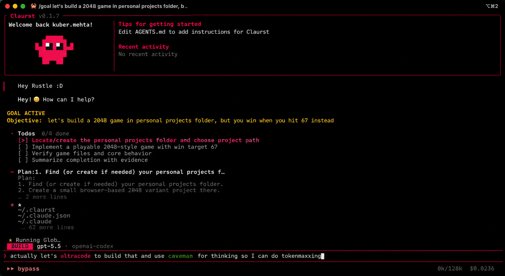

<div align="center">

<h1>CLAURST</h1>
<h2><em>Agentic Coding for Builders who Ship</em></h2>


<p>
    <a href="https://github.com/kuberwastaken/claurst"></a>
    <a href="https://github.com/kuberwastaken/claurst"></a>
    <a href="https://github.com/kuberwastaken/claurst/blob/main/LICENSE.md"></a>
</p>

<br />


</div>

---

Claurst is an **open-source, multi-provider terminal coding agent** built from the ground up in Rust. It started as a clean-room reimplementation of Claude Code's behavior (from [spec](https://github.com/kuberwastaken/claurst/tree/main/spec)) and has since evolved into an amazing TUI pair programmer with multi-provider support, a rich UI, plugin system, a companion named Rustle, chat forking, memory consolidation, and much more.

It's fast, it's memory-efficient, it's yours to run however you want, and there's no tracking or telemetry.

---

> [!IMPORTANT]
> **Claurst is now officially in Beta (v0.2.0).** The core agent, multi-provider routing, and TUI are stable enough for daily driving — expect rough edges around experimental features (flagged below). Bug reports and PRs welcome.

> [!NOTE]
> **Recent Updates (v0.2.0, see the [changelog](docs/changelog.md)):**
>
> - **Sandbox and permissions:** on macOS, Bash commands run in a Seatbelt sandbox that limits writes to the workspace and blocks network by default (`/sandbox-toggle`). Bash approvals are matched per command, approvals can be saved for the current project, and `--allowed-tools` / `--disallowed-tools` are enforced. See [Permission rules](docs/configuration.md#permission-rules-and-approvals) and [Shell Sandbox](docs/configuration.md#shell-sandbox).
>
> - **Hooks:** Claude Code's hooks contract (settings shape, events, JSON stdin/stdout, exit code 2, timeouts), including plugin hooks. See [Hooks](docs/hooks.md).
>
> - **Skills and instruction files:** `AGENTS.md` and `CLAUDE.md` files are loaded from the git root down to the working directory, with `@include`; skills from `.claurst/skills`, `.agents/skills` and `.claude/skills` are listed to the model. See [Instruction files](docs/configuration.md#instruction-files-agentsmd--claudemd) and [Skills](docs/configuration.md#skills).
>
> - **Headless runs:** typed `stream-json` events, documented exit codes, `--resume` / `--continue`, and `--json-schema` for a structured answer. See [Headless mode](docs/advanced.md#headless-mode).
>
> - **Providers:** Anthropic prompt caching and adaptive thinking; ChatGPT (Codex) subscription token refresh, prompt caching and reasoning replay; one retry policy and context compaction for every provider.
>
> - **/share support:** Use `/share` to share chat sessions with others via unlisted GitHub Gists. `[EXPERIMENTAL]`
>
> - **Free Mode:** Try out Free in '/connect' to get a great agentic coding experience in Claurst for absolutely free (or as good as free gets you :P). `[EXPERIMENTAL]` 
>
> - **/goal support:** Try out `/goal <objective>` to see claurst keep working an objective, spanning multiple turns instead of stopping after one normal turn. `[EXPERIMENTAL]`
>
> - **ultracode:** The **highest effort level** — pick it in the effort selector (`/effort`, where it sits past `max` on the "Smarter" end with an animated purple spectrum) or just type **`ultracode`** anywhere in your prompt. The keyword lights up with a purple gradient (claurst's take on Claude Code's `ultrathink`) and that turn runs at the model's top reasoning **plus** a disciplined plan → delegate → integrate → verify workflow that fans bounded packets out across native subagents (`Agent`), swarms (`TeamCreate`), and background tasks (`TaskCreate`). Composes with `/goal` for sustained multi-turn objectives. `[EXPERIMENTAL]`

---

# Getting Started

## Quick install (one-liner)

**Linux / macOS:**

```bash
curl -fsSL https://github.com/kuberwastaken/claurst/releases/latest/download/install.sh | bash
```

**Windows (PowerShell):**

```powershell
irm https://github.com/kuberwastaken/claurst/releases/latest/download/install.ps1 | iex
```

This drops `claurst` into `~/.local/bin` (or `%LOCALAPPDATA%\Programs\claurst` on Windows; Git Bash uses the same Windows path) and adds it to your `PATH` automatically. Open a new terminal and run `claurst`.

## Via npm / bun

If you have Node.js or Bun installed, you can install Claurst as a global package. The postinstall script automatically downloads the right pre-built binary for your platform.

```bash
# npm
npm install -g claurst

# bun
bun install -g claurst

# or run without installing
npx claurst
bunx claurst
```

To upgrade later, run:

```bash
claurst upgrade
```

> Pin a specific version with `--version 0.1.0` on either installer, or `claurst upgrade --version 0.1.0`.

## Manual download

If you'd rather grab the binary yourself, the latest archives are on [**GitHub Releases**](https://github.com/kuberwastaken/claurst/releases):

| Platform | Archive |
|----------|---------|
| **Windows** x86_64 | `claurst-windows-x86_64.zip` |
| **Linux** x86_64 | `claurst-linux-x86_64.tar.gz` |
| **Linux** aarch64 | `claurst-linux-aarch64.tar.gz` |
| **macOS** Intel | `claurst-macos-x86_64.tar.gz` |
| **macOS** Apple Silicon | `claurst-macos-aarch64.tar.gz` |

Each archive contains a single `claurst` (or `claurst.exe`) binary. Extract it and put it on your `PATH`.

## Build from source

```bash
git clone https://github.com/kuberwastaken/claurst.git
cd claurst/src-rust
cargo build --release --package claurst

# Binary is at target/release/claurst
```

**Raspberry Pi / systems without ALSA** (e.g. Debian Trixie, headless servers):

```bash
# Build without voice/microphone support — no libasound2-dev required
cargo build --release --package claurst --no-default-features
```

## First run

```bash
# Set your API key (or use /connect inside Claurst to configure)
export ANTHROPIC_API_KEY=sk-ant-...

# Or sign in with a ChatGPT subscription (Codex)
claurst codex login

# Start Claurst
claurst

# Or run a one-shot headless query
claurst -p "explain this codebase"

# Headless with one JSON event per line, or a structured answer
claurst -p --output-format stream-json "fix the failing test"
claurst -p --output-format json --json-schema schema.json "is this branch ready to merge?"
```

Claurst asks before running commands and editing files; see [Permission modes](docs/configuration.md#permission-modes). Project instructions go in `AGENTS.md` or `CLAUDE.md` at the repository root.

## Devcontainer setup

After cloning this repository, open it in VS Code and use Reopen in Container to start the development environment.

Prerequisites:
- Docker installed on your host machine: https://www.docker.com/products/docker-desktop/

GPG and SSH forwarding is enabled in the devcontainer, given you have it set up on your host machine. Follow [this guide](https://code.visualstudio.com/remote/advancedcontainers/sharing-git-credentials) if you need help with that.

### Devcontainer features

- Base image: `rust:1-bullseye`.
- Preinstalled build dependencies: `gnupg2`, `libasound2-dev`, `libxdo-dev`, and `pkg-config`.
- Devcontainer features enabled: `common-utils` (with `vscode` user `uid/gid 1000` and Zsh install disabled), `git`, and `docker-outside-of-docker` (`moby: false`).
- Runs as `vscode` user by default.
- Persistent Cargo caches via named volumes for `/usr/local/cargo/registry` and `/usr/local/cargo/git`.
- Binds local `.claurst` into `/home/vscode/.claurst` for local settings/session history access.
- Sets `GNUPGHOME=/home/vscode/.gnupg` and prepends `src-rust/target/debug` and `src-rust/target/release` to `PATH`.
- Post-create setup creates and permissions `.gnupg`, and fixes ownership for `/usr/local/cargo`.
- VS Code setting `terminal.integrated.inheritEnv` is enabled.

## Editor integration (Agent Client Protocol)

Claurst speaks the [**Agent Client Protocol (ACP)**](https://agentclientprotocol.com) — the open protocol pioneered by Zed for editor-to-agent communication. Any ACP-compatible editor (Zed, Neovim, JetBrains plugins, …) can drive Claurst as a subprocess and present it in the editor's native chat UI.

To use Claurst as the agent in your editor, point its ACP integration at:

```
command: claurst
args:    ["acp"]
```

**Zed example** (`~/.config/zed/settings.json`):

```jsonc
{
  "agent_servers": {
    "claurst": {
      "command": "claurst",
      "args": ["acp"]
    }
  }
}
```

Claurst will run in JSON-RPC 2.0 mode over stdio. It implements `initialize`, `session/new`, `session/prompt`, and `session/cancel`, streams `session/update` notifications (text deltas, agent thinking, tool calls with their progress + results), and evaluates tool permissions with the same rules as the TUI, sending only the calls that need approval to `session/request_permission` so the editor can show a native approval dialog. Each session uses the settings, instruction files and trusted MCP servers of its working directory.

Configure your provider / API key in `~/.claurst/settings.json` (or `claurst auth login`, `claurst codex login`, or `/connect` inside the TUI) before launching — the ACP agent uses the same credentials and providers as the interactive TUI.

Enable verbose ACP logging (to stderr — never stdout, which would corrupt the protocol) by setting `CLAURST_ACP_LOG=debug`.

### Listing on the ACP Registry

The [Agent Client Protocol registry](https://github.com/agentclientprotocol/registry) is the canonical directory editors look up when offering "available agents". To get Claurst listed:

1. Fork [`agentclientprotocol/registry`](https://github.com/agentclientprotocol/registry).
2. Create a `claurst/` folder at the repo root and drop in the prepared manifest from this repo: [`src-rust/crates/acp/registry-template/agent.json`](src-rust/crates/acp/registry-template/agent.json). Bump the `version` and release-archive URLs to match the latest GitHub release.
3. Add `claurst/icon.svg` (16×16 recommended) — the Rustle logo from [`public/`](public/) is a fine starting point.
4. Open a PR to the registry. The registry CI validates `agent.json` against [the schema](https://github.com/agentclientprotocol/registry/blob/main/agent.schema.json) before merge.

After merge, Zed and other ACP-aware editors will pick up Claurst on their next registry refresh.

## Documentation

For more info on how to configure Claurst, [head over to our docs](https://claurst.kuber.studio/docs).

>**PS:** The original breakdown of the findings from Claude Code's source that started this project is on [my blog](https://kuber.studio/blog/AI/Claude-Code's-Entire-Source-Code-Got-Leaked-via-a-Sourcemap-in-npm,-Let's-Talk-About-it) - the full technical writeup of what was found, how the leak happened, and what it revealed.

---

## Contributing

Claurst is built for the community, by the community and we'd love your help making it better.
Please see and include AGENTS.md for project-specific rules (for both humans and agents).

[Open an issue](https://github.com/Kuberwastaken/claurst/issues/new) for bugs, ideas, or questions, or [Raise a PR](https://github.com/Kuberwastaken/claurst/pulls/new) to fix bugs, add features, or improve documentation.

---

## Important Notice

This repository does not hold a copy of the proprietary Claude Code TypeScript source code.
This is a **clean-room Rust reimplementation** of Claude Code's behavior.

The process was explicitly two-phase:

**Specification** [`spec/`](https://github.com/kuberwastaken/claurst/tree/main/spec) — An AI agent analyzed the source and produced exhaustive behavioral specifications and improvements, deviated from the original: architecture, data flows, tool contracts, system designs. No source code was carried forward.

**Implementation** [`src-rust/`](https://github.com/kuberwastaken/claurst/tree/main/src-rust) — A separate AI agent implemented from the spec alone, never referencing the original TypeScript. The output is idiomatic Rust that reproduces the behavior, not the expression.

This mirrors the legal precedent established by Phoenix Technologies v. IBM (1984) — clean-room engineering of the BIOS — and the principle from Baker v. Selden (1879) that copyright protects expression, not ideas or behavior.

---

